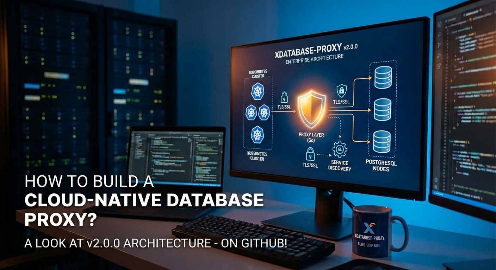

# XDatabase Proxy



A small, dependency-light database connection router for PostgreSQL (and compatibles), Redis, ClickHouse, MongoDB and any TLS-first protocol. Clients connect to one endpoint and the proxy picks the backend from the **username** in the login or from the **TLS server name (SNI)**. It runs in Kubernetes, containers, VMs and bare metal.

```
postgresql://user.<deployment>[.pool]@proxy:5432/db
```

- `user.db-prod` → service of deployment `db-prod` (direct)
- `user.db-prod.pool` → the pooled service (pgbouncer, odyssey, …) of the same deployment
- Plain `user` with TLS host `db-prod.pool.example.com` → the same pooled service, chosen by SNI when the Service allows it (`xdatabase-proxy-routing: sni` or `all`; also works with PostgreSQL 17 `sslnegotiation=direct`)

The proxy strips the routing suffix before forwarding, so the backend sees plain `user`. If `database` is empty or equals the full login (psql's default), it becomes `postgres`.

Full documentation: https://hasirciogluhq.github.io/xdatabase-proxy/ (sources in [docs/](docs)): [getting started](docs/getting-started.md), per-database guides for [PostgreSQL](docs/databases/postgresql.md), [Redis](docs/databases/redis.md), [ClickHouse](docs/databases/clickhouse.md) and [MongoDB/TLS](docs/databases/mongodb.md), [configuration](docs/configuration.md), [upgrading](docs/upgrading.md).

## Supported databases

| Database | `DATABASE_TYPE` | Routing | Status |
| --- | --- | --- | --- |
| PostgreSQL | `postgresql` | Login `user.deployment[.pool]`, TLS terminated by the proxy | ✅ Supported |
| PostgreSQL-compatible: CockroachDB, YugabyteDB, TimescaleDB, Citus, Greenplum, QuestDB, CrateDB (Aurora/AlloyDB PostgreSQL need nothing special) | `postgresql` or the product name (`cockroachdb`, `yugabytedb`, `timescaledb`, `citus`, `greenplum`, `questdb`, `cratedb`) | Same as PostgreSQL | ✅ Same code path. Wire handling is covered by tests; not yet run against the real products |
| Redis | `redis` | Login `user.deployment[.pool]` in `AUTH`/`HELLO … AUTH`, and/or TLS SNI passthrough | ✅ Supported, e2e-tested with real Redis |
| ClickHouse (native protocol) | `clickhouse` | Login in the Hello packet, and/or TLS SNI passthrough | ✅ Supported, e2e-tested with real ClickHouse |
| MongoDB, any TLS-first protocol | `mongodb`, `tls` | TLS SNI `deployment[.pool].your-domain`, passed through to the backend | ✅ Supported, e2e-tested with real MongoDB 8 (passthrough and terminate) |
| MySQL / MariaDB | – | The server speaks first and the password scramble is bound to the backend | 📋 Planned, hardest |

One proxy instance serves one `DATABASE_TYPE`. Which routing strategy (username or SNI) may reach a route is chosen by the cluster administrator with the Service label `xdatabase-proxy-routing: username | sni | all`; without it each type has a default. Details: [Routing strategies](docs/routing-strategies.md).

**TLS handling:** PostgreSQL, and username routing for Redis and ClickHouse, terminate TLS at the proxy. SNI routes default to passthrough (the backend terminates TLS and the client sees the backend's certificate) and can terminate at the proxy with `SNI_TLS_MODE=terminate` (the backend may then be plain TCP).

**MongoDB limits:** routing needs the client to use TLS and send the server name (SNI); plaintext connections or clients without SNI are closed. Routing by username is not possible, because MongoDB sends the user only after the server answered `hello`. With passthrough the client must trust the backend's certificate (or use options like `tlsAllowInvalidCertificates` for a self-signed one); with `SNI_TLS_MODE=terminate` it sees the proxy's certificate.

## Roadmap & a promise

As promised, XDatabase Proxy is no longer just a PostgreSQL router: Redis, ClickHouse, MongoDB and any TLS-first protocol are now in, along with SNI routing and TLS termination or passthrough.

And here is a new promise: if I make it, this will grow into a truly universal database proxy. Every top-tier database will get first-class support, and the goal is for it to become an indispensable tool for platforms.

Next up: MySQL / MariaDB (the hardest one, since the server speaks first and the password scramble is bound to the backend), then wider real-world testing of the PostgreSQL-compatible and ClickHouse paths. Ideas, bug reports and contributions are very welcome, see [CONTRIBUTING.md](CONTRIBUTING.md).

## How it is built

| Concern | Implementation |
| --- | --- |
| PostgreSQL wire protocol | [`pgx/pgproto3`](https://github.com/jackc/pgx) |
| Redis / ClickHouse login | Small bounded readers for the first `AUTH`/`HELLO` command and the native Hello packet |
| SNI | ClientHello peeked with `crypto/tls`, then passed through or terminated |
| Kubernetes | `client-go` shared informer with a route index (no polling, O(1) lookup) |
| Logging | `log/slog` (JSON) |
| TLS | `crypto/tls`, self-signed ECDSA P-256 generated on demand, TLS ≥ 1.2 |

Layout: `pkg/` holds reusable pieces (`proxy` TCP server/pipe, `tlsutil`); `cmd/proxy/internal/` holds project-specific code (`config`, `route`, `discovery`, `postgres`, `gateway`, `protocol`, `tlsstore`, `health`).

## Deployment

All manifests are Kustomize bases under [`kubernetes/`](kubernetes):

| Path | What it deploys |
| --- | --- |
| `kubernetes/base` | Namespace, ServiceAccount, least-privilege RBAC (`list/watch services`, own TLS secret only) |
| `kubernetes/production/nodeport` | 3-replica Deployment, `NodePort` Service (30432, `externalTrafficPolicy: Local`), PDB |
| `kubernetes/production/daemonset-hostport` | DaemonSet, one proxy per node on `hostPort 5432`, no Service hop |
| `kubernetes/development` | 1 replica, debug logs, in-memory TLS, `-development` image |
| `kubernetes/test` | Throw-away PostgreSQL with the discovery labels |

```bash
kubectl apply -k kubernetes/production/nodeport          # or .../daemonset-hostport
kubectl apply -k kubernetes/development && kubectl apply -n xdatabase-proxy -f kubernetes/test/postgresql.yaml
```

Pin the image to a version tag (`2.2.0`, `2.2`; image tags have no `v`) or digest in production. Images are multi-arch, distroless, non-root, and published with SBOM and provenance attestations.

**Container / VM** (static routing, no Kubernetes needed):

```bash
docker run -p 5432:5432 -e STATIC_BACKENDS="db1=10.0.0.5:5432,db1.pool=10.0.0.5:6432" \
  ghcr.io/hasirciogluhq/xdatabase-proxy:2.2.0
```

For Kubernetes discovery outside a cluster set `KUBECONFIG` (and optionally `KUBE_CONTEXT`).

## Service discovery (Kubernetes)

Label a Service and it becomes routable:

| Label | Meaning |
| --- | --- |
| `xdatabase-proxy-enabled: "true"` | opt in |
| `xdatabase-proxy-database-type: postgresql` | protocol, must equal the proxy's `DATABASE_TYPE` (`postgresql`, `redis`, `clickhouse`, `mongodb`, `tls`) |
| `xdatabase-proxy-deployment-id: <id>` | routing key |
| `xdatabase-proxy-pooled: "true"` | pooled endpoint (default `false`) |
| `xdatabase-proxy-destination-port: <port or name>` | optional, defaults to the first port; a value matching no port is an error |
| `xdatabase-proxy-routing: username \| sni \| all` | optional, which strategies may reach the Service; default depends on the database type |

If several Services share a route, the one with the lowest `namespace/name` wins and the proxy logs one warning naming every candidate.

## Configuration

| Variable | Default | Description |
| --- | --- | --- |
| `DATABASE_TYPE` | `postgresql` | `postgresql` (or a compatible product name), `redis`, `clickhouse`, `mongodb`, `tls` |
| `SNI_TLS_MODE` | `passthrough` | `passthrough` or `terminate` for SNI routes (not for `postgresql`); `terminate` needs `TLS_ENABLED=true` |
| `PROXY_START_PORT` | `5432` | Listener port |
| `HEALTH_SERVER_PORT` | `8080` | `/health` (liveness), `/ready` (readiness) |
| `DEBUG` | `false` | Debug logging |
| `MAX_CONNECTIONS` | `10000` | Concurrent client limit (`0` = unlimited) |
| `DIAL_TIMEOUT_SECONDS` | `5` | Backend resolve + dial timeout |
| `DISCOVERY_MODE` | auto | `static` if `STATIC_BACKENDS` is set, else `kubernetes` |
| `STATIC_BACKENDS` | – | `deployment[.pool]=host:port,…` |
| `WATCH_NAMESPACE` | all | Restrict discovery to one namespace (then a Role is enough) |
| `CLUSTER_DOMAIN` | `cluster.local` | Used to build service DNS names |
| `KUBECONFIG`, `KUBE_CONTEXT` | – | Kubernetes access outside a pod |
| `NAMESPACE` | pod namespace | Namespace of the TLS secret |
| `TLS_ENABLED` | `true` | Offer TLS to clients; forced off for `mongodb`/`tls` in passthrough mode |
| `TLS_MODE` | auto | `file` (if `TLS_CERT_FILE`), `kubernetes` (if `TLS_SECRET_NAME`), else `memory` |
| `TLS_CERT_FILE`, `TLS_KEY_FILE` | – | Certificate files |
| `TLS_SECRET_NAME` | – | `kubernetes.io/tls` Secret (created if missing) |
| `TLS_AUTO_GENERATE` | `true` | Generate a self-signed cert when none exists |
| `TLS_RENEWAL_THRESHOLD_DAYS` | `30` | Re-issue **our own** self-signed cert this long before expiry; certificates you provide are never replaced |

Certificates are re-checked every 6 hours and hot-swapped, so cert-manager rotations need no restart.

## Hardening

- Startup packets are size-limited by `pgproto3` (10 kB), startup has a 10 s deadline, negotiation attempts are capped (no recursion).
- Redis/ClickHouse logins and TLS ClientHellos are read with fixed size limits and a 10 s deadline.
- Connection cap, graceful shutdown: on SIGTERM the listener closes and sessions get 25 s to finish.
- Startup parameters and passwords are never logged.
- Minimal dependency set, `go mod verify`, `govulncheck` and Trivy in CI, Dependabot for Go modules, actions and base image.
- Pods run non-root with a read-only filesystem and all capabilities dropped.
- `CancelRequest` is not routable (it carries no user); clients simply fall back to their own timeout.

## Development

```bash
go test -race ./...
scripts/dev-run.sh          # proxy on :6432 → postgres on localhost:5432
scripts/local-deploy.sh     # build, load and deploy to a local cluster
```

CI (`.github/workflows/ci.yaml`): format, vet, race tests, govulncheck, manifest rendering, image build + scan, and `scripts/e2e.sh` as a matrix job against real PostgreSQL, Redis, ClickHouse and MongoDB. Pushing a `v*` tag runs `publish.yaml`: multi-arch image, SBOM + provenance, GitHub release from `CHANGELOG.md`.

## License

Licensed under the [Apache License 2.0](LICENSE), free for any use including commercial; no fees or revenue limits. Contributing: [CONTRIBUTING.md](CONTRIBUTING.md). Conduct: [CODE_OF_CONDUCT.md](CODE_OF_CONDUCT.md). Security: [SECURITY.md](SECURITY.md). Help: [SUPPORT.md](SUPPORT.md). Issues: https://github.com/hasirciogluhq/xdatabase-proxy/issues
